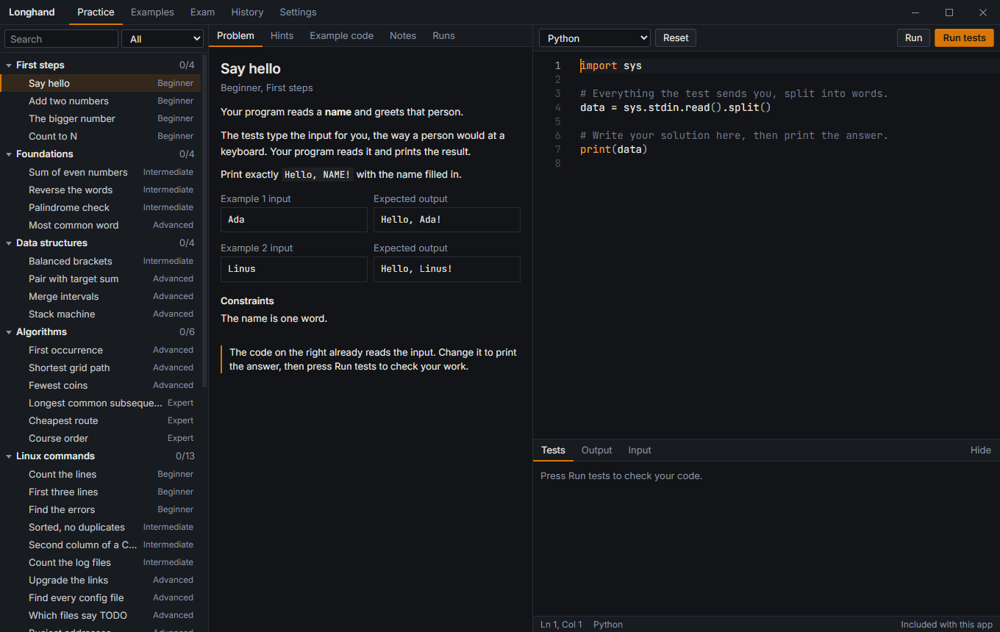

<div align="center">


# Longhand

**Practise coding the way the exam will feel. No autocomplete, no AI.**

[](https://github.com/Rathio12/Longhand/releases/latest)
[](https://github.com/Rathio12/Longhand/actions/workflows/release.yml)
[](https://github.com/Rathio12/Longhand/releases)
[](LICENSE)


[Download for Windows](https://github.com/Rathio12/Longhand/releases/latest) · [Report an issue](https://github.com/Rathio12/Longhand/issues/new)

</div>



An offline desktop app for practising code before exams where AI tools are banned. Write the code yourself, run it against test cases, and sit timed practice exams. Then see exactly where your answers went wrong. It stays offline unless you turn on updates.

## Run it from source

You need [Node.js](https://nodejs.org) 22 or newer.

```
npm install
npm start
```

Use `npm run dev` to work on the app with live reload. `npm run dist` builds a Windows installer in `release/`.

The installer comes with every language ready to use, with nothing else to set up. The one exception is Swift, because on Windows it depends on Microsoft's build tools, which can't be redistributed. If you have your own copy of a language, the app uses yours.

When running from source, `npm run runtimes` downloads the same bundled tools. See [THIRD-PARTY.md](THIRD-PARTY.md) for their licenses.

## What's inside

- **Practice:** problems from Beginner to Expert, each with hidden tests, notes and three levels of hints. A full solution is never shown.
- **Topics:** first steps, foundations, data structures, algorithms, Linux commands, defensive cybersecurity and game logic.
- **Examples:** runnable examples in every language across basics, data structures, algorithms, cybersecurity and game development, plus Linux shell techniques. Each language's basics are also on an Example code tab next to each problem.
- **Exam:** a full-screen timed exam. The clock can't be paused and keeps running if the app closes. Copy and paste can be blocked, and leaving the window is logged. Paper mode removes colours, line numbers and running code.
- **Exam review:** every answer compared with the expected output, test by test, with the first difference pointed out. Hidden tests are revealed at this point.
- **History:** past exams, their timestamped logs and your test runs.

The exam lock is a practice aid, not a proctoring tool. It can't stop someone using another device.

Your code runs as a normal program on your computer, with your user's permissions and no sandbox. Read code from other people before you run it.

## Languages

Built in: Python, JavaScript, TypeScript, Java, C#, C++, C, Go, Rust, Kotlin, Swift, Dart, Ruby, PHP, Lua, Perl, R and Bash.

Linux problems run in your own Bash if you have one. Otherwise they use the bundled BusyBox shell, which handles every built-in problem but doesn't have Bash extras such as arrays.

For games: GDScript runs in Godot without opening a window. Unity-style C#, Unreal-style C++ and LÖVE-style Lua are ordinary console programs with small look-alike types, so they practise the logic without needing the engine.

Anything else can be added in Settings, if it runs from a command line. To add one to the app itself, add an entry in `electron/languages.cjs`.

## Question packs

A pack is a JSON file, imported from Settings. Tests send `input` to the program and compare what it prints with `output`. Trailing spaces and line ending differences are ignored. Mark at least one test as `sample` to show it to the student.

```json
{
  "name": "Week 3 revision",
  "problems": [
    {
      "title": "Double it",
      "difficulty": "Intermediate",
      "statement": "Read a number and print **twice** its value.",
      "constraints": "0 ≤ n ≤ 1000",
      "hints": ["The idea", "Useful functions", "Plain-language steps"],
      "tests": [
        { "input": "4\n", "output": "8\n", "sample": true },
        { "input": "0\n", "output": "0\n" }
      ]
    }
  ]
}
```

`difficulty` is one of `Beginner`, `Intermediate`, `Advanced` or `Expert`.

Optional fields: `language` limits a problem to one language id such as `bash`, `starter` sets its starting code, and a test's `files` creates files for it, as in `{ "notes/a.txt": "hello" }`.

## Project layout

| Path | What it holds |
|---|---|
| `electron/` | Window, saved data and code execution |
| `src/views/` | The five screens |
| `src/components/` | Editor, console and shared controls |
| `src/data/` | Built-in problems and examples |
| `src/monaco.js` | Editor setup. Suggestion and hover modules are deliberately not imported |
| `electron/app-config.json` | The GitHub link used by the Settings buttons and the updater |
| `scripts/fetch-runtimes.mjs` | Downloads and verifies the bundled language tools |

## Publishing a release

Raise `version` in `package.json` and push to `main`. GitHub Actions builds the installer and publishes a release for any version that doesn't have one yet.

Installed copies with **Update automatically** turned on in Settings fetch the newest release. It's off by default, and it never runs during an exam.

## Known issues

Small, real and good places to start contributing:

- The exam clock trusts the computer's time, so changing the system clock changes how long is left.
- The window forgets its size and position when the app closes.
- Collapsed topics in the Practice list open again when you switch screens.

## License

MIT. See [LICENSE](LICENSE).
